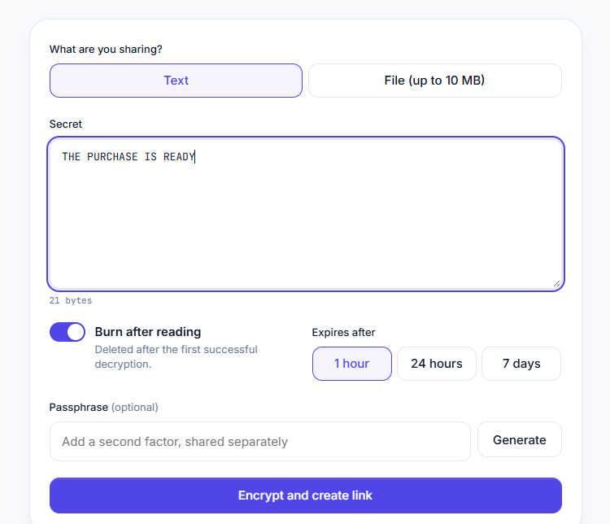
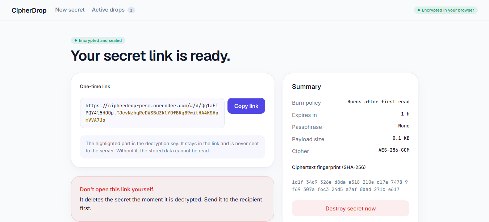
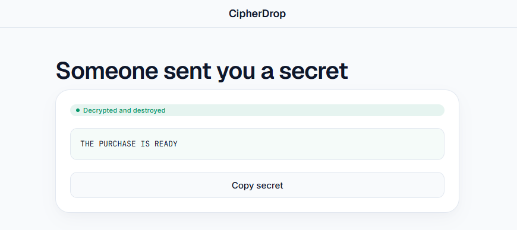

# CipherDrop

**Zero-knowledge, one-time secret and file sharing.** Everything is encrypted in the sender's
browser. The decryption key lives only in the link, so the server never sees it.

**Live demo:** https://cipherdrop-prsm.onrender.com (free hosting: it sleeps after 15 minutes idle, so the
first visit can take about a minute, and drops are lost when it restarts)

[](https://render.com/deploy?repo=https://github.com/AKPAN-THANKGOD/cipherdrop)



| Link ready | Recipient view |
|---|---|
|  |  |

## Features

- Share text (up to 100 KB) or a file (up to 10 MB).
- Burn after reading: the drop is deleted when it is first opened.
- Expires after 1 hour, 24 hours or 7 days.
- Optional passphrase as a second layer. Five wrong attempts destroy the drop.
- Creators can destroy a drop early, or burn all of their drops at once.
- No accounts, no analytics, no request logging.
- Plain HTML, CSS and JavaScript on the front end. Node.js (Fastify) and Redis on the back end.

## How it works

```
Sender's browser                          Server                     Recipient's browser
 random 256-bit key
 encrypt (AES-256-GCM)  --ciphertext-->   stores ciphertext only
 link = site/#/d/<id>.<key>                                           opens link
        key stays in the #fragment,       <--ciphertext (on open)--   key from the #fragment
        which browsers never send                                     decrypts locally
```

- Text or file, and a file's name and type, are all inside the encrypted payload.
- A passphrase adds a second layer derived with PBKDF2-SHA256 (600,000 rounds). The browser
  sends the server only a separate verifier, never the passphrase or the key.
- Reading a burn-after-reading drop is atomic on the server, so two people can't both get it.

See [SECURITY.md](SECURITY.md) for the threat model and how to report a problem.

## Run it locally

Requires Node.js 20 or newer.

```
git clone https://github.com/AKPAN-THANKGOD/cipherdrop.git
cd cipherdrop
npm install
node server.js
```

Open http://localhost:3000. Without `REDIS_URL`, drops are kept in memory. That is for
development only: they are lost on restart and work for a single process.

### With Docker and Redis

```
docker compose up --build
```

Redis runs with persistence off, so nothing is written to disk.

## Configuration

| Variable | Default | Purpose |
|---|---|---|
| `PORT` | `3000` | Port to listen on |
| `REDIS_URL` | unset | Redis connection string. Unset means the in-memory dev store |
| `TRUST_PROXY` | `0` | Set to `1` behind a reverse proxy so rate limits use real client IPs |

## Limits

- Files up to 10 MB, text up to 100 KB.
- Rate limits per IP on creating and opening drops.
- 50 MB of uploads per client per 24 hours. Only a salted hash of the IP is kept, and it expires after 24 hours.

## Deploy

**Render (free tier).** Click the Deploy to Render button above, or create a Web Service from this
repository with build command `npm install`, start command `node server.js`, health check path
`/health` and the environment variable `TRUST_PROXY=1`. HTTPS is included.

**Your own server with HTTPS.** You need Docker, a domain name, and ports 80 and 443 open.

1. Point a DNS `A` record for your domain at the server.
2. Copy `.env.example` to `.env` and set `DOMAIN` to your domain.
3. Run `docker compose -f docker-compose.prod.yml up -d --build`.

Caddy gets and renews the HTTPS certificate automatically. Redis and the app are not exposed to
the internet, and access logs are turned off.

## Project layout

```
server.js                 API, security headers, rate limits, dev store
public/                   index.html, styles.css, app.js (all encryption happens here)
Dockerfile, docker-compose.yml, docker-compose.prod.yml, Caddyfile
render.yaml               Render blueprint
```

## Known limitations

- Browsers need HTTPS (or localhost) for the Web Crypto API, so serve it behind HTTPS.
- A burn-after-reading drop is deleted when it is fetched, so a recipient who closes the
  page before saving the secret cannot get it back.
- The "Active drops" list is stored in the creator's browser only.
- Passphrases use PBKDF2, not Argon2id.
- Anyone who has the full link can read the secret. Share it over a channel you trust.

## License

[MIT](LICENSE)
